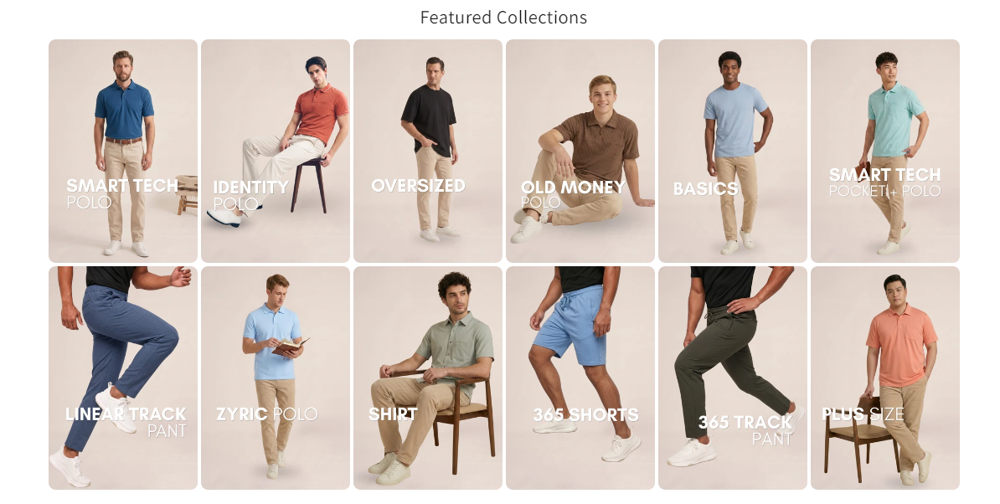

# Featured Categories Grid

*Maxzone Clothing (Shopify) — custom section, built Oct 2026*

## What it is
A custom section that renders a **responsive grid** of featured
collections. Dawn (Shopify's default theme) only offers a slider layout
for this — no grid option — so this was built from scratch, with
independent column counts for desktop/tablet/mobile controlled entirely
from the theme editor.

## Key features
- Responsive CSS grid (not a slider), per-breakpoint column control
- Repeatable blocks (image, title, subtitle, link, badge) — no code
  changes needed to add/reorder categories
- Responsive images (`srcset`/`sizes`), optional badges, hover zoom
- Below-image or overlay (solid/gradient) text styles
- Safari-specific CSS fixes

## Tech
Shopify Liquid, theme editor schema, CSS Grid, vanilla JavaScript

## Files
- [`featured-categories.liquid`](./featured-categories.liquid) — full section code
