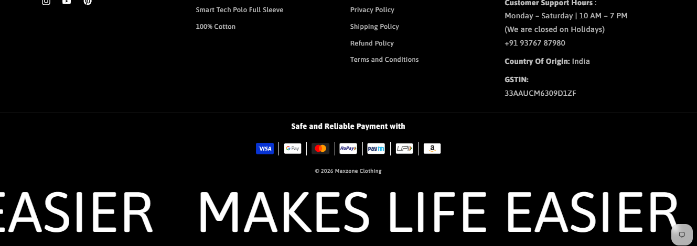
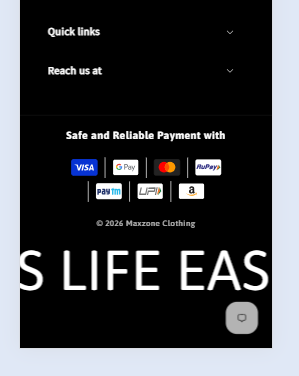

# Scrolling Footer Text

*Maxzone Clothing — custom feature, built September 2025*

## What it is
A continuously scrolling marquee-style text strip ("Makes Life Easier")
added to the site footer, added directly into the existing `footer.liquid`
file (not a separate section) using CSS keyframe animation and a small
JS snippet to seamlessly loop the text.

## How it works
- The text is duplicated via JavaScript (`cloneNode`) and appended right
  after the original, so the `translateX(-100%)` animation loops
  seamlessly with no visible gap or jump.
- Font size scales down on mobile via a media query.

## Tech
Shopify Liquid, CSS (keyframe animation), vanilla JavaScript

## Files
- [`scrolling-footer-text.liquid`](./scrolling-footer-text.liquid) — the full code (style + markup + script)
