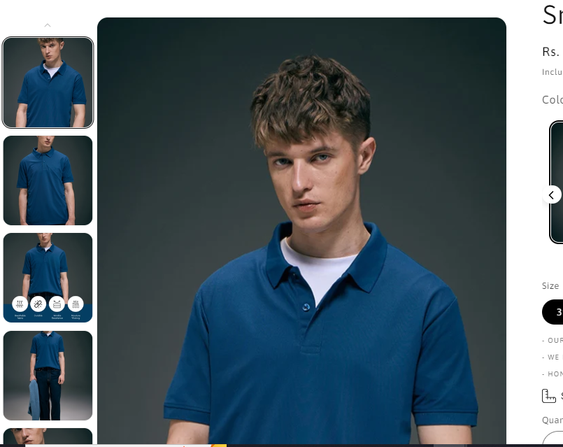

# Vertical Product Image Thumbnails

*Maxzone Clothing — custom feature, built June 2025*

## What it is
Dawn's "Thumbnail carousel" media layout only supports a **horizontal**
thumbnail strip on desktop. This feature rotates and repositions that
strip into a **vertical** thumbnail column instead, without touching
Dawn's core theme files.

## How it works
- CSS rotates the thumbnail slider and its items 90°, repositioning it
  absolutely along the left edge of the main product media.
- JS measures the main product image's rendered height and sets that as
  the (rotated) thumbnail strip's width, so it always matches the main
  image's height exactly — recalculated on load, on resize, and when
  crossing the 986px breakpoint.
- Below 986px, the width override is reset so mobile/tablet keeps Dawn's
  default horizontal layout untouched.

## Tech
Shopify Liquid (script placement), vanilla JavaScript (`matchMedia`,
dynamic sizing), CSS (`transform: rotate`, `transform-origin`)

## Setup
1. On the product page, under Product information → Media, set the
   desktop layout to **Thumbnail carousel** (required for this to work).
2. Add the contents of `vertical-thumbnails.js` at the end of
   `main-product.liquid`.
3. Add the contents of `vertical-thumbnails.css` to the bottom of
   `base.css`.
4. Applies to desktop/large screens only (≥986px) — mobile/tablet keep
   the default horizontal layout.

## Files
- [`vertical-thumbnails.js`](./vertical-thumbnails.js) — sizing/viewport logic
- [`vertical-thumbnails.css`](./vertical-thumbnails.css) — layout/rotation styles
