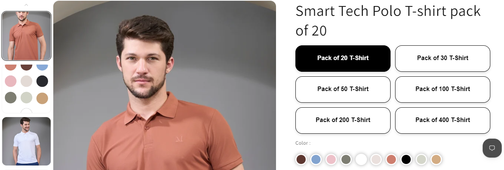

# B2B Pack Navigation

*Maxzone Clothing — custom snippet feature, built April 2025*



## What it is

A custom product-page navigation feature developed for the Shopify Dawn theme to help B2B customers switch between different pack sizes of the same product. It displays pack options as clickable buttons, allowing customers to navigate directly to the corresponding product page without manually searching for alternative bulk quantities. This is a custom-built feature and is not included in the default Dawn theme.

## How it works

- Displays multiple pack-size options for the same product, including packs of 20, 40, 60, 100, 200, and 400 T-shirts.
- Links each button to its corresponding Shopify product page.
- Uses Shopify Liquid to compare the current product handle against each pack's handle.
- Highlights the currently selected pack with a black background and white text.
- Uses a two-column CSS grid layout to organize pack options efficiently and optimize available space.
- Applies consistent button sizing, rounded corners, spacing, and typography for a uniform appearance.
- Includes hover effects with a background color change and a slight upward movement.
- Uses responsive styling to adjust button height, font size, and padding on smaller mobile screens.
- Includes additional CSS rules to reposition the multivariant app's alert message above its product selection block.

## Tech

Shopify Liquid, HTML, CSS, responsive CSS Grid, Shopify product handles, theme asset loading

## Setup

1. **Add the snippet:** Create `mvBoxofCustom.liquid` in the theme's `snippets/` folder and paste in the provided Liquid and HTML code.

2. **Add the CSS asset:** Create `mvBoxofCustom.css` in the theme's `assets/` folder and paste in the corresponding CSS.

3. **Add the snippet to a product page:** Open the product template in the Shopify theme editor and add a Custom Liquid block where you want the pack navigation to appear.

4. **Render the snippet:** Insert the following code into the Custom Liquid block:

   ```liquid
   
   ```

5. **Configure product links:** Update the product URLs, pack labels, and corresponding product handles in the snippet to match the available B2B pack sizes.

6. **Test navigation:** Open each pack's product page and verify that its corresponding button is highlighted and that clicking another pack navigates to the correct product.

7. **Check responsiveness:** Preview the product page on desktop and mobile to confirm the two-column layout, button sizing, and hover effects.

## Where used

B2B product pages for products offered in multiple bulk pack sizes. The snippet can be added to any product page through a Custom Liquid block.

## Files
- [`mvBoxofCustom.liquid`](./mvBoxofCustom.liquid) — contains the pack navigation markup, product links, and active-pack detection.
- [`mvBoxofCustom.css`](./mvBoxofCustom.css) — css code of the snippet
