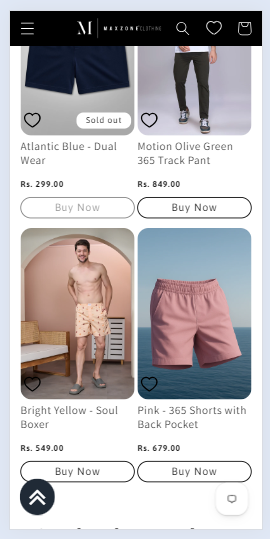

# Back to Top Button

*Maxzone Clothing — custom snippet feature, built November 2024*



## What it is

A custom back-to-top button developed for the Shopify Dawn theme. The button appears as a circular floating icon on the left side of the screen when the user scrolls upward after passing a specified scroll threshold. Clicking it smoothly returns the user to the top of the page. This feature is not included by default in the Dawn theme.

## How it works

- Displays a fixed circular button near the bottom-left corner of the viewport.
- Keeps the button hidden by default and reveals it only when the user scrolls upward beyond a 300px scroll threshold.
- Hides the button when the user scrolls downward or returns near the top of the page.
- Uses JavaScript scroll detection to track the current and previous scroll positions.
- Implements smooth scrolling to the top when the button is clicked.
- Uses Font Awesome 4.0.3 to display the double-up arrow icon.
- Allows the trigger threshold and bottom positioning to be adjusted through Liquid variables.
- Uses custom CSS for the button's background color, size, circular shape, fixed positioning, and visibility.

## Tech

Shopify Liquid, HTML, CSS, vanilla JavaScript, Font Awesome 4.0.3, browser scroll events

## Setup

1. **Create the snippet:** Add `back-to-the-top.liquid` to the theme's `snippets/` folder and paste in the complete snippet code.

2. **Render the snippet:** Open `layout/theme.liquid` and add the following immediately before the opening `<body>` tag:

   ```liquid
   
   ```

3. **Customize the trigger threshold:** Adjust the `vertical_offset_for_trigger` variable in the snippet. The default value is `300` pixels.

4. **Adjust the button position:** Change the `position_from_bottom` variable to control the distance between the button and the bottom of the viewport.

5. **Test the feature:** Preview the storefront, scroll down beyond the threshold, then scroll upward to verify that the button appears. Click it to confirm that the page smoothly returns to the top.

## Where used

Available throughout the storefront wherever the snippet is rendered in `layout/theme.liquid`.

## Files
- [`back-to-the-top.liquid`](./back-to-the-top.liquid) — full Snippet code

