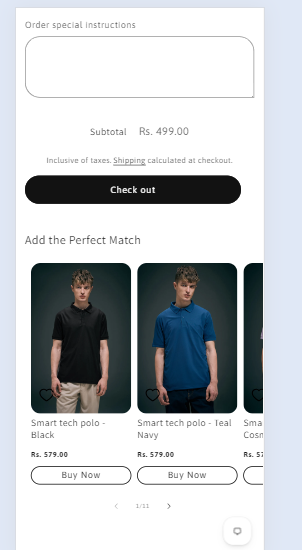

# Cart Upsell

*Maxzone Clothing — custom section, built March 2026*

## What it is

A custom cart upsell feature developed for the Shopify Dawn theme that displays a featured collection on the cart page to encourage customers to discover and purchase additional products. It dynamically hides products that are already in the cart and suppresses the recommendations when the cart is empty or contains products tagged `B2B`. This feature is custom-built and is not included in the default Dawn theme.

## How it works

- Uses an existing Featured Collection section on the cart page to display recommended products.
- Checks the cart contents and hides the recommendation section when the cart is empty.
- Detects products tagged `B2B` and hides the Featured Collection section when any such product is present in the cart.
- Fetches the current cart data from Shopify's `/cart.js` endpoint to identify products already added to the cart.
- Compares cart product handles with the handles of products displayed in the featured collection.
- Hides products that are already in the cart to avoid recommending duplicate purchases.
- Restores visibility for recommended products that are not currently in the cart.
- Listens for the `cart:updated` event to refresh recommendations after cart changes.
- Includes a guard against multiple simultaneous cart requests.

## Tech

Shopify Liquid, HTML, CSS, vanilla JavaScript, Shopify Ajax Cart API (`/cart.js`), DOM manipulation, custom events

## Setup

1. **Create the custom Liquid file:** Add `cart-upsell.liquid` to the theme's `snippets/` folder, or keep the code in a Custom Liquid block as described below.

2. **Add a Featured Collection section:** On the cart page template, add a Featured Collection section above the Custom Liquid block containing the upsell code.

3. **Update the section ID:** In `cart-upsell.liquid`, replace both occurrences of `shopify-section-template--23577249120550__featured_collection_8GEhi8` with the actual section ID of the Featured Collection section added to your cart page.

4. **Add the upsell code:** Paste the code into a Custom Liquid block on the cart page, below the Featured Collection section. Alternatively, if using a snippet, render it from the appropriate cart template or section.

5. **Verify product handles:** Ensure the Featured Collection product links use standard `/products/product-handle` URLs so the script can identify products already in the cart.

6. **Test cart behavior:** Verify that recommendations are hidden when the cart is empty, products already in the cart are hidden from the recommendations, and the section disappears when a cart item has the `B2B` tag.

## Where used

Cart page only. The feature uses a Featured Collection section as the recommendation display and filters its products according to the current cart contents.

## Files
- [`cart-upsell.liquid`](./cart-upsell.liquid) — full section code

