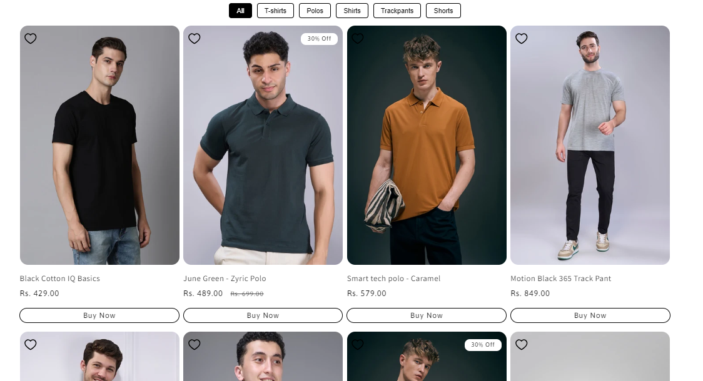
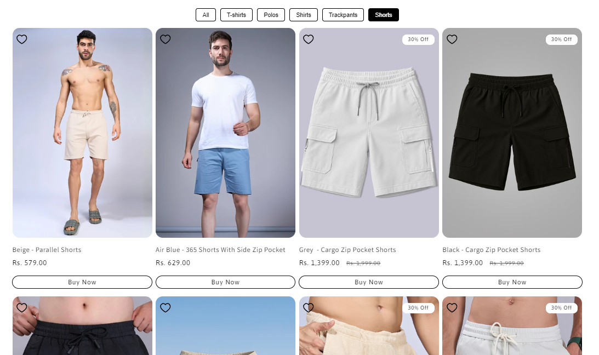
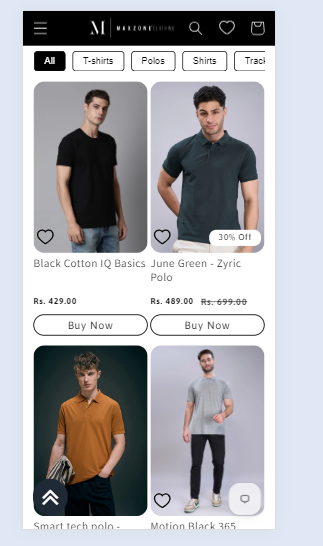

# Collection Tabs

*Maxzone Clothing — custom section, built October 2025*

## What it is

A custom Shopify Dawn theme section that displays products from multiple collections within a single section using switchable tabs. Instead of placing separate collection sections on the page, customers can switch between collections without navigating away, saving page space and reducing browsing time. This section is custom-built and is not included in the default Shopify Dawn theme.

## How it works

- Displays customizable tab buttons for different product collections.
- Loads each tab's products from the collection selected in the Shopify theme editor.
- Supports custom tab titles, with the collection title used as the default when no custom title is provided.
- Displays up to eight products per collection using Dawn's existing `card-product` snippet.
- Supports configurable product image ratios, image shapes, secondary images, vendor names, ratings, and quick-add functionality.
- Includes an optional **View all** button for each collection, linking directly to its collection page.
- Uses JavaScript to switch between tab panels without reloading the page.
- Provides a horizontally scrollable tab navigation on mobile devices, with hidden scrollbars to maintain a clean layout.
- Uses responsive Dawn product grid classes to display two columns on smaller screens and four columns on desktop.

## Tech

Shopify Liquid, HTML, CSS, vanilla JavaScript, Shopify section schema, Dawn `card-product` snippet

## Setup

1. **Add the section file:** Create `collection-tabs.liquid` in the theme's `sections/` folder and paste in the complete section code.

2. **Open the theme editor:** Navigate to the page template where you want the collection tabs to appear.

3. **Add the section:** Select **Multi-Tabs** from the available sections.

4. **Configure the section:** Set the section title and adjust the product image ratio, image shape, vendor visibility, ratings, secondary images, and quick-add settings.

5. **Add collection tabs:** Add blocks using the **Tab** block type, select a collection for each block, and optionally enter a custom tab title.

6. **Configure the View all button:** Enable or disable **Show view all** for each tab as needed.

7. **Save and test:** Preview the page on desktop and mobile to verify tab switching, product cards, horizontal tab scrolling, and collection links.

## Where used

Available for use on Shopify storefront pages where the custom **Multi-Tabs** section is added through the theme editor. Designed to display multiple product collections in a compact, interactive layout.

## Files

- [`collection-tabs.liquid`](./collection-tabs.liquid) — full section code

