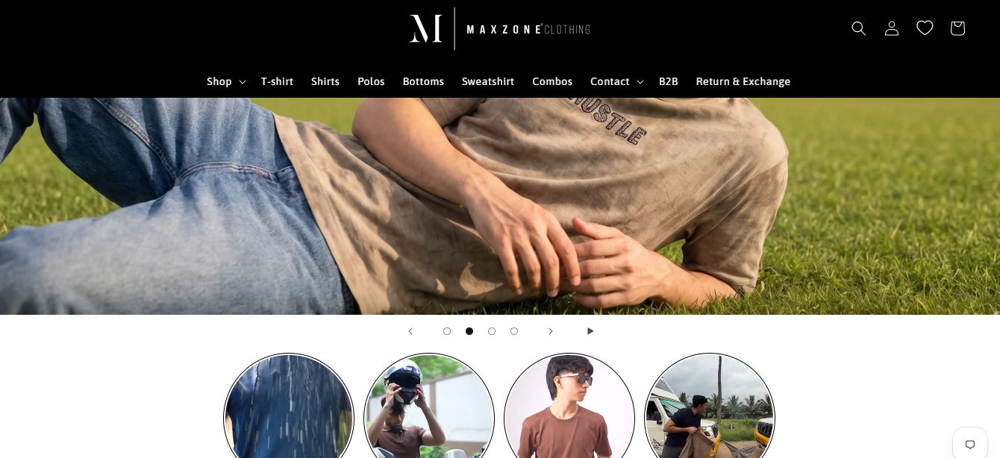

# Dynamic Homepage Transparent Header on Scroll

*Maxzone Clothing — custom feature, built May 2025*




## What it is

A custom scroll-responsive header feature developed for the Shopify Dawn theme and specifically implemented on the homepage. Initially, the header appears transparent over the page content, with black text, icons, and a black logo. When the user hovers over the header or scrolls down past the header's scroll threshold, its background changes to black and its content changes to white. When the user scrolls back to the top, the header returns to its transparent appearance.

## How it works

- Positions the header absolutely over the homepage content, giving it a transparent background.
- Sets the header text, navigation links, and icons to black in the initial transparent state.
- Changes the header background to black and its content to white when hovered or when the `scrolled-past-header` class is applied.
- Uses CSS transitions to animate background and text color changes.
- Dynamically switches between black and original logo assets based on the header wrapper's computed background transparency.
- Checks for header logo elements and updates their image sources to maintain the appropriate logo appearance.
- Includes responsive CSS adjustments for desktop search icon visibility and header layouts with a centered logo.
- Uses a separate CSS snippet to fix mega menu layout and search icon visibility in the theme's main stylesheet.

## Tech

Shopify Liquid, HTML, CSS, vanilla JavaScript, DOM manipulation, computed styles, responsive media queries

## Setup

1. **Add the header code:** Copy the contents of `Transparent_header.liquid` directly into `layout/theme.liquid`, inside the `<body>` tag. To apply the feature only to the homepage, wrap the code in this Liquid condition:

   ```liquid
   
     <!-- Paste the complete Transparent_header.liquid code here -->
   
   ```

2. **Add the CSS adjustments:** Copy the contents of `Transparent_header.css` into `assets/base.css`.

3. **Verify the logo asset:** Ensure the black logo URL referenced in the JavaScript points to the correct image.

4. **Test the homepage:** Confirm that the header is transparent with black content at the top, changes to a black background with white content on hover or after scrolling, and returns to its transparent appearance when the user scrolls back to the top.

5. **Check desktop responsiveness:** Verify that the search icon, centered-logo layout, and mega menu display correctly at desktop widths.


## Where used

Homepage only. The feature modifies the header's appearance based on its hover and scroll state.

## Files

- [`Transparent_header.liquid`](./Transparent_header.liquid) — contains the header styling, scroll-state appearance rules, and JavaScript for dynamic logo switching.

- [`Transparent_header.css`](./Transparent_header.css) — contains additional header layout and desktop search icon adjustments intended for assets/base.css.
