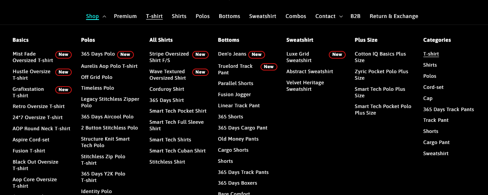

# Header Menu Open on Hover

*Maxzone Clothing — custom feature, built March 2025*



## What it is

A custom feature built for the Shopify Dawn theme that allows desktop navigation dropdowns and mega menus to open when the user hovers over a menu item, instead of requiring a click. The feature includes a theme editor checkbox to enable or disable hover-based menu opening.

## How it works

- Uses JavaScript `mouseenter` events to open main navigation dropdowns and nested submenu items on hover.
- Automatically closes a previously opened main menu when another main menu is opened.
- Closes menus when the cursor leaves the menu area, with a 350ms delay to prevent accidental closing during cursor movement.
- Handles nested submenu interactions separately to support multi-level navigation.
- Adds a **"Open menu with hover (dropdown and megamenu only)"** checkbox to the Shopify theme editor's header settings.
- Loads the JavaScript file conditionally when the checkbox is enabled, keeping the feature optional.

## Tech

Shopify Liquid, JSON schema settings, HTML, vanilla JavaScript, DOM events

## Setup

1. **Add the JavaScript asset:** Create `header-dropdown-hover.js` in the theme's `assets/` folder and add the custom hover-menu JavaScript code.

2. **Add the theme setting:** Open `sections/header.liquid` and add the following checkbox object inside the section's `` settings array:

   ```json
   {
     "type": "checkbox",
     "id": "menu_hover",
     "label": "Open menu with hover (dropdown and megamenu only)",
     "default": false
   }
   ```

3. **Load the JavaScript conditionally:** In `sections/header.liquid`, add the following code in both specified locations associated with the desktop navigation markup:

   ```liquid
   
     <script src="{{ 'header-dropdown-hover.js' | asset_url }}" defer="defer"></script>
   
   ```

   - **First location:** Add it immediately after the closing `</nav>` tag for the desktop navigation inside the `` block.
   - **Second location:** Find `` in the header navigation logic and add the same code immediately below that condition's associated navigation markup, after its closing `</nav>` tag.

4. **Enable the feature:** Open the Shopify theme editor, navigate to the header settings, and enable **Open menu with hover (dropdown and megamenu only)**.

5. **Test the navigation:** Preview the storefront on desktop and verify that dropdowns and mega menus open on hover and close after the cursor leaves the menu area.

## Where used

The header navigation of the Shopify Dawn theme. The feature applies to desktop dropdown menus and mega menus when enabled in the theme editor.

## Files

- [`header-dropdown-hover.js`](./header-dropdown-hover.js) — JS logic for opening and closing navigation menus on hover.
