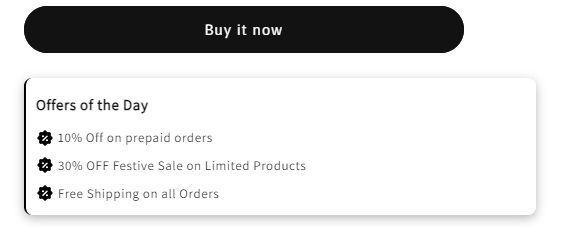
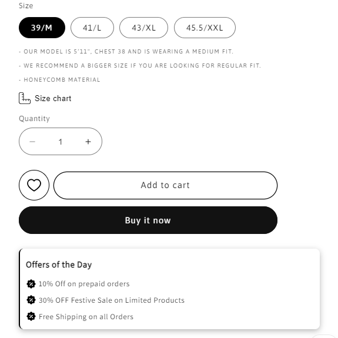

# Offers block on Product Page

*Maxzone Clothing — custom feature, built January 2025*

## What it is

A custom offers display UI added to the product page in the Shopify Dawn theme. It presents daily offers in a styled container with discount icons and offer text, helping highlight promotions directly on the product page.

## How it works

- Displays an **"Offers of the Day"** heading followed by a list of promotional offers.
- Each offer includes an inline SVG discount icon and customizable offer text.
- Uses a left border, rounded corners, padding, and a box shadow to visually distinguish the offer container from surrounding product information.
- Includes custom CSS for typography, icon alignment, spacing, and list styling.
- Supports multiple offers by adding additional `<li class="offer">` elements to the list.
- The offer content is hardcoded in the HTML and can be updated directly in the markup.

## Tech

Shopify Liquid (Dawn theme integration), HTML, CSS, inline SVG

## Setup

1. Open `sections/main-product.liquid` in the Shopify Dawn theme.
2. Locate the `` case inside the product section's block-rendering logic.
3. Add the offer UI code after the end of the `buy_buttons` block, or at another suitable location inside `main-product.liquid`.
4. Update the heading and placeholder offer text to match the promotions you want to display.
5. Save the file and preview a product page to verify the layout and spacing.

## Where used

Product pages in the Shopify Dawn theme, wherever the offer UI markup is added inside `main-product.liquid`.

## Files

- [`offer_block.liquid`](./offer_block.html) — contains the offer UI markup and CSS.

