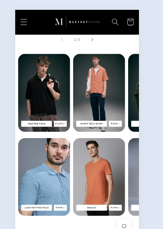
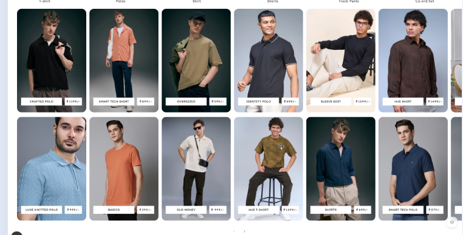

# Parallel Collection Slider

*Maxzone Clothing — custom section, built November 2024*

## What it is
A custom horizontally-scrolling collection slider where each slide shows
**two stacked images** (a "parallel" pair) instead of one — not a layout
available in Dawn's default collection list section.

## Key features
- Each slider block holds **two independent image + title + link
  combinations**, rendered stacked within a single slide.
- Built on top of Dawn's existing slider component (`slider-component`,
  `component-slider.css`) so native prev/next controls and swipe
  behavior are reused rather than rebuilt from scratch.
- Custom rounded-corner cards with a text overlay (collection name) on
  each image.
- Responsive: fixed slide width on desktop, viewport-relative width on
  tablet/mobile; slider nav buttons hidden on mobile in favor of native
  swipe/scroll.
- Configurable via the theme editor: title, columns, color scheme,
  mobile columns, swipe behavior, section padding — up to 15 blocks (30
  images total since each block holds 2).

## Tech
Shopify Liquid (section + schema), CSS (custom slider/card overrides on
top of Dawn's base styles)

## Setup
Add `parallel-collection-slider.liquid` to the theme's `sections/`
folder — it registers as "Collection slider" in the theme editor's
section picker. Add it to any template, then add blocks and set an
image + title + link for both the 1st and 2nd collection per block.

## Files
- [`parallel-collection-slider.liquid`](./parallel-collection-slider.liquid) — full section code
