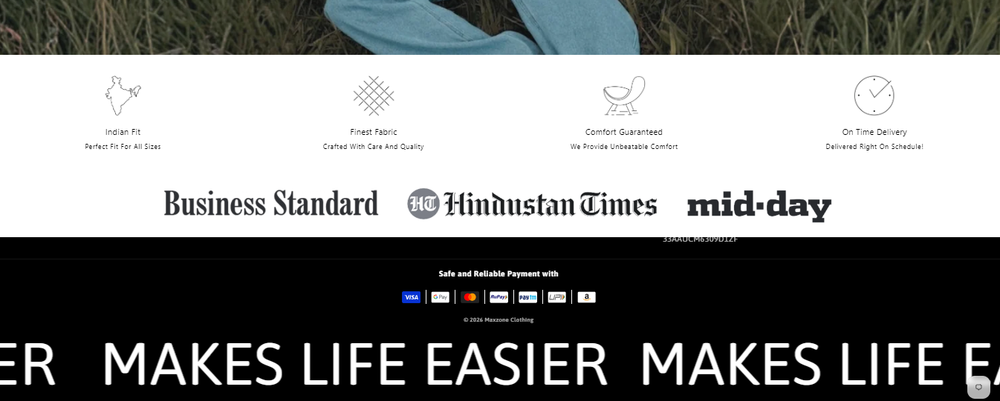
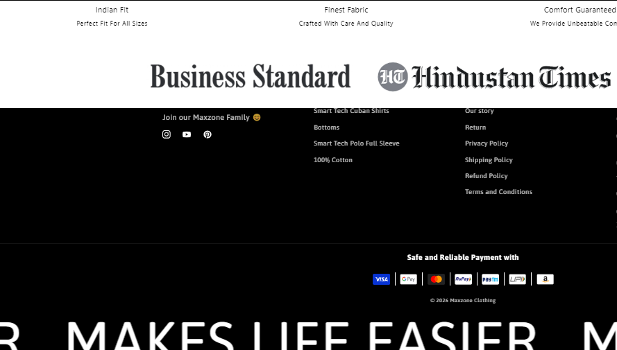

# Sticky Footer Reveal on Scroll

*Maxzone Clothing — custom feature, built November 2024*

## What it is

A custom scroll-based footer reveal effect that creates the illusion of the footer sitting behind the main page content. As the user scrolls toward the bottom of the page, the content moves upward, progressively revealing the fixed footer underneath. This creates a layered scrolling experience without requiring additional JavaScript.

## How it works

- Fixes the footer to the bottom of the viewport using `position: fixed`.
- Positions the main content and selected footer-group sections above the footer using `z-index` and background colors.
- Allows the page content to scroll over the footer, gradually revealing it as the user approaches the bottom of the page.
- Applies stacking order and spacing adjustments to selected sections to maintain the intended layered effect.
- Includes specific styling for the cart page to adjust its main content positioning and bottom spacing.
- Uses CSS alone to achieve the effect without JavaScript-based scroll listeners.

## Tech

CSS, Shopify theme section selectors, CSS positioning (`fixed` and `relative`), `z-index`, stacking contexts

## Setup

1. Open `assets/base.css` in the Shopify theme.
2. Add the footer reveal CSS code to the stylesheet.
3. Verify that the footer, main content, and relevant footer-group sections use the expected selectors and stacking order.
4. Review the newsletter section selector in the CSS. Update `#shopify-section-sections--23577240863014__newsletter_hRFRpD` if the corresponding section ID differs in the target theme.
5. Preview the storefront and scroll to the bottom of a page to confirm that the content moves over the fixed footer and reveals it progressively.
6. Test the cart page separately to verify its additional positioning and spacing rules.

## Where used

Storefront pages using the custom CSS in `assets/base.css`, with additional positioning adjustments for the cart page.

## Files
 
- [`Footer-reveal-effect.css`](./Footer-reveal-effect.css) — contains the CSS responsible for the sticky footer reveal effect.